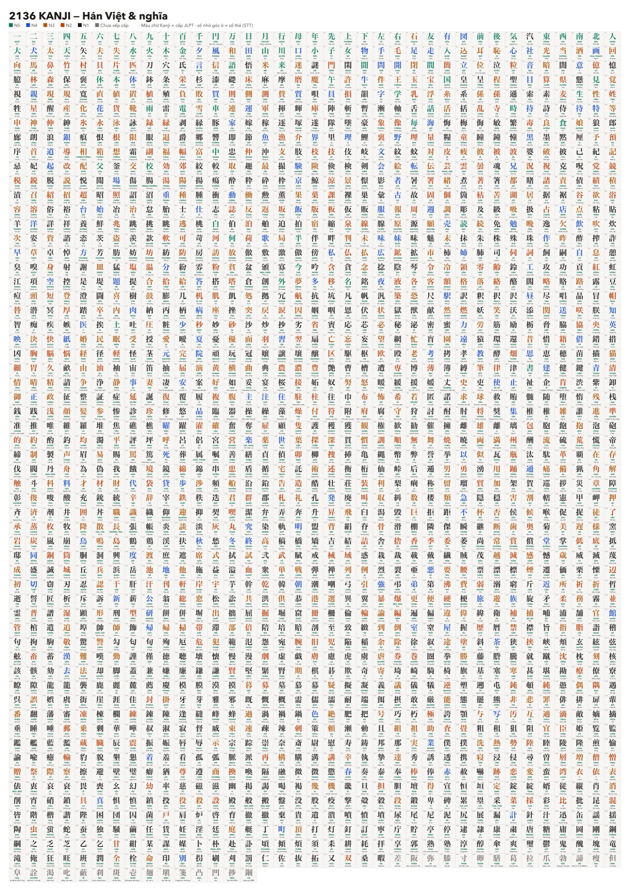

# 🖼️ Poster & hình nền 2136 Kanji

Toàn bộ 2.161 chữ Kanji của bộ thẻ trên **một tấm poster** để in dán tường, cùng **2 hình nền** cho máy tính. Mỗi ô có **số thẻ (STT)**, chữ Kanji tô màu theo cấp JLPT, **âm Hán Việt** và **nghĩa tiếng Việt**.

**Màu chữ Kanji:** 🟢 N5 · 🔵 N4 · 🟠 N3 · 🔴 N2 · ⚫ N1 · ⚪ xám = chưa xếp cấp.

## 📄 Poster in A0 (dán tường)

| File | Dùng để | Dung lượng |
|---|---|---|
| [⬇ **PDF khổ A0**](kanji-poster/poster-2136-kanji-A0.pdf) | Mang ra tiệm in (đúng khổ 84,1 × 118,9 cm, 300 dpi) | 15 MB |
| [⬇ JPG gốc 9933 × 14043 px](kanji-poster/poster-2136-kanji-A0.jpg) | Khi tiệm in chỉ nhận ảnh | 23 MB |

- 37 cột × 59 hàng, mỗi ô khoảng **2,2 × 1,9 cm**. Đứng cách tường 30–50 cm là đọc được nghĩa.
- Nền trắng, chữ đậm. Nên in **giấy mờ (matte)** hoặc **decal** để không bị lóa đèn.
- Chữ xếp theo thứ tự sách, nên các chữ giống nhau nằm cạnh nhau (ví dụ 門 閑 聞 問 開 閉 間).

## 💻 Hình nền máy tính (2 màn hình)

Bộ chữ chia đôi cho 2 màn hình để chữ đủ to (không có số thẻ, để chữ to hơn):

| Ảnh | Chữ | Tỉ lệ |
|---|---|---|
| [⬇ Hình nền 1](kanji-poster/wallpaper-1-mac-16x10.jpg) | thẻ 1 → 1081 | 16:10 (MacBook 2560 × 1664) |
| [⬇ Hình nền 2](kanji-poster/wallpaper-2-16x9.jpg) | thẻ 1082 → 2165 | 16:9 (màn hình rời 3360 × 1890) |

**Cách đặt trên Mac:** tải ảnh về, nhấp phải vào file trong Finder → **Set Desktop Picture**. Nếu có 2 màn hình, mở System Settings → Wallpaper và chọn ảnh riêng cho từng màn.

> Xem thêm: [🃏 Xem thẻ Kanji](kanji-viewer/index.html) · [🎮 Game Kanji](kanji-viewer/game.html) · [📊 Bảng 2136 Kanji](kanji-2136/index.html)
